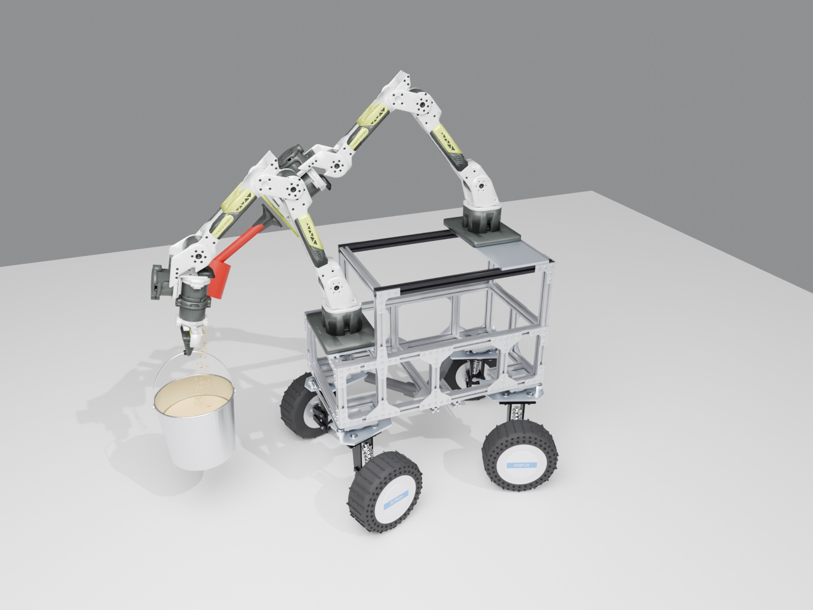
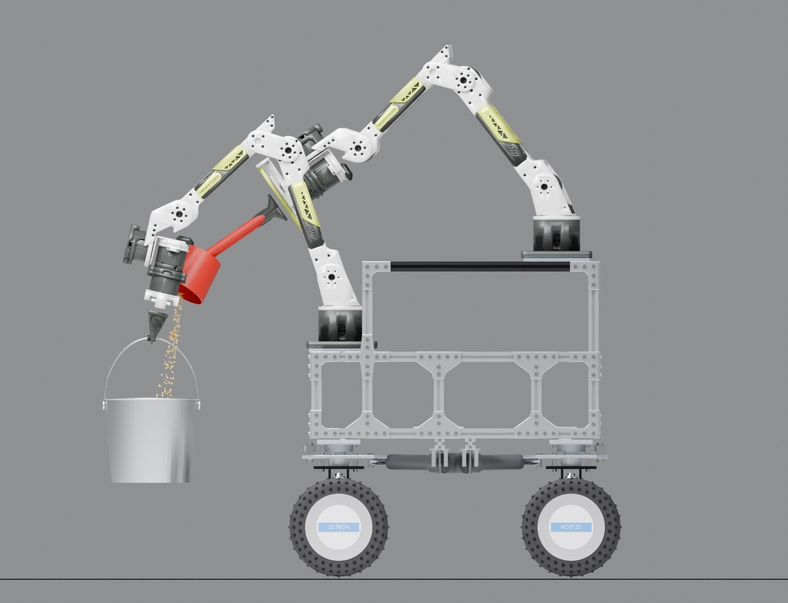
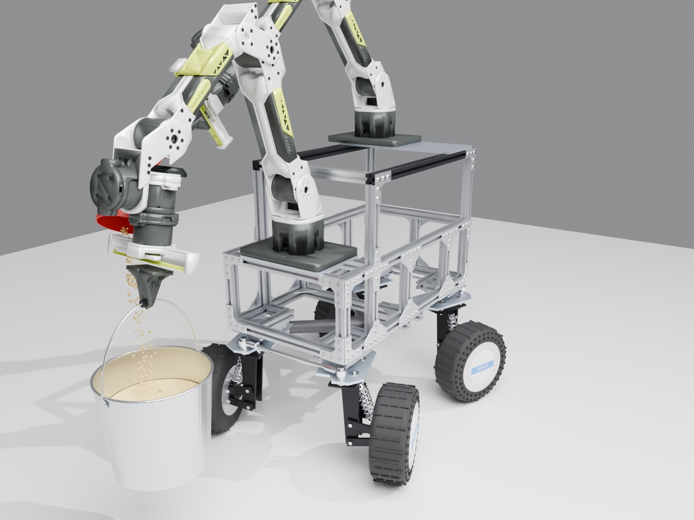
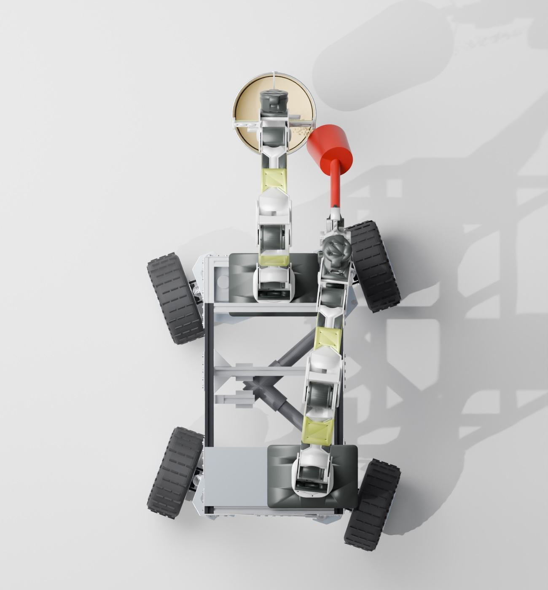

# Two reBot B601-DM arms on Cemani (plan, not bought yet)

Arm 1 sits on the front low box (unchanged, plate below). Arm 2 sits on the back of the tall box top, across the two black
top rails (its plate is TBD). They work as a pair: arm 1 holds or grabs low and out front, arm 2 reaches forward over the body
to help.

Arm: Seeed reBot Arm B601-DM (open source, github.com/Seeed-Projects/reBot-DevArm). 6 joints + gripper, Damiao motors,
4.7 kg, 1.5 kg rated payload, 767 mm reach with gripper, 24 V (runs off Cemani's 24 V LiFePO4 on its own breaker),
USB-CAN board to the Jetson Orin Nano. ROS2, LeRobot, Python SDK all marked done in their repo (checked 11/18/2026).
Assembled bundle $1,658 each, so $3,316 for two; Star Arm 102 leader arm (for teaching it jobs) $200 separate.

## Mounting plate (arm 1, front low box)
`rebot-mount-plate.dxf` (made by `make_arm_plate.py`), preview `rebot-mount-plate.png`.
- 200 x 130 mm, 1/4 in 6061, same as the steering plates.
- Arm holes copied from Seeed's base plate STEP: 4x M4 (4.6 mm) on a 64 mm square, 4x M3 (3.2 mm) on a 26.88 mm square,
  screws go up from below into the arm's base.
- Sits across the two top cross rails of the front low box (about 100 mm centre to centre, judged from the
  11/11 tape photo MEASURE_side.jpg; the Blender model's 137.5 is too long), 8 M5 slots (26 mm long) into drop-in T-nuts, so
  the real spacing can be off by +-10 mm. The M4 screw heads fit in the 80 mm gap between the rails.
- Cardboard test first, same as the steering plates. The antenna on the front deck has to move; the tall box top now carries
  arm 2, so the antenna's new spot is TBD.

## Arm 2 (back of the tall box top)
Plate TBD. In the renders it is a placeholder 305 x 130 mm plate across the two black top rails, centred 200 mm behind the
middle of the robot, with the arm 130 mm right of centre so it clears arm 1 when both reach forward.

Tip check (model numbers, arm 1 alone): arm + 1.5 kg at full forward reach is about 2.5 kg·m about the front axle, against about
8 kg·m from the robot's own weight, so roughly 3x margin.

## What it will look like (plan as of 11/18/2026)
4-wheel steering (rear axle = front axle mirrored, turning the opposite way for tight turns), the frame sized to the real
robot, arm 1 on its plate on the front low box holding a feed pail, and arm 2 on the back of the tall box reaching over the
body to pour a scoop of feed into it. Made by `render/render_cemani_with_arm.py` from the frame v3 model and
Seeed's own arm model; arm 2's pose was solved from the same URDF so its gripper lands over the pail.

| Side | Front | Top |
|---|---|---|
|  |  |  |
