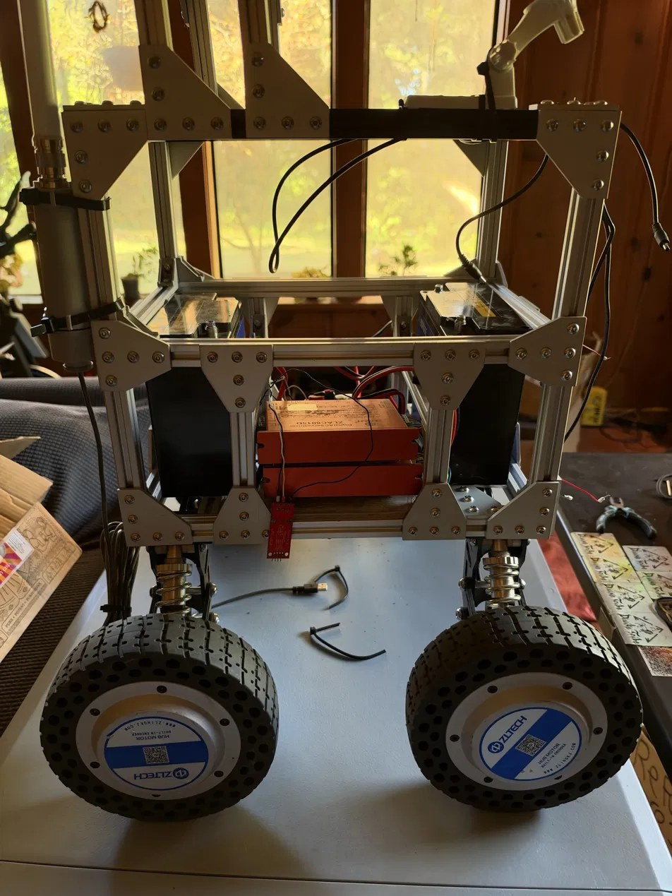
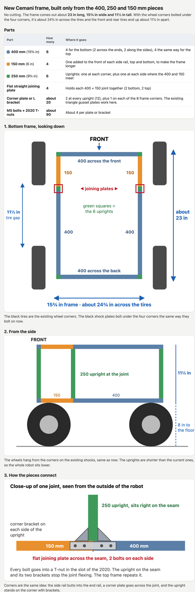
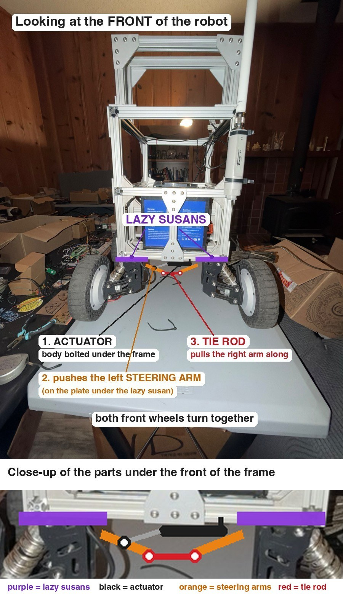
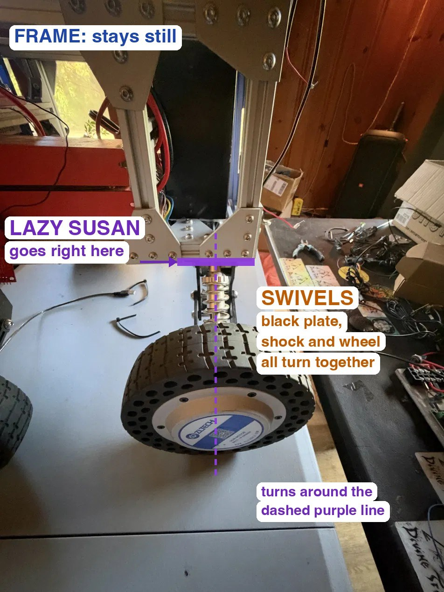

# Cemani rebuild, October 2026: longer frame and front steering

> **Update, October 25:** [frame v2](frame-v2/README.md) replaces the frame below. It's stiffer (cross rails at the wheel mounts, 8 uprights, a gusset at every joint, a one-piece top plate), the batteries sit low in the middle, and every board has a set spot. The steering plan below still applies.

Cemani sat for about five months after a wheel came off. The rebuild fixes the two things that bothered me most when it drove: the shudder in turns, and how easily a tall robot on a short footprint could tip.

The shudder is skid steer. With four fixed wheels, the tires get dragged sideways every time it turns. The fix is to steer the front wheels and let the Teensy slow the inside wheels in a turn, so nothing scrubs.

## The current build, measured

| What | Size |
|---|---|
| Frame, front to back | 400 mm (about 16 in) |
| Frame, side to side | about 12 in |
| Outside of left tire to outside of right tire | 21 in |
| Tires past the frame on each side | about 4½ in |
| Gap between front and rear tire | 4½ in |
| Tire diameter | 8 in |
| Floor to the underside of the frame | about 8 in |

The front and rear wheel centers are only about 12½ in apart, so the robot tips forward and back more easily than side to side. That 4½ in gap also leaves almost no room for a front wheel to turn before it hits the rear tire.

Measurement photos: [frame side](photos/measure-IMG_7729.jpg), [frame length](photos/measure-IMG_7730.jpg), [ground clearance](photos/measure-IMG_7731.jpg), [tire](photos/measure-IMG_7732.jpg), [tire overhang](photos/measure-IMG_7733.jpg).

## New frame

Built only from 2020 pieces already on hand (400, 250 and 150 mm), no cutting.

| Part | Count |
|---|---|
| 400 mm 2020 | 8 |
| 150 mm 2020 | 4 |
| 250 mm 2020 | 6 |
| Flat straight joining plates | 4 |
| Corner plates or L brackets | about 20 |
| M5 bolts and T-nuts | about 90 |

Each side rail is a 400 and a 150 joined with a flat plate, with a 250 upright standing right on the joint so it can't flex. That gives a frame about 23 in long, 15¾ in wide and 11½ in tall. With the same wheel corners it's about 24¾ in across the tires, which still fits through a 30 in door. The gap between front and rear tires grows to about 11½ in.

## Front steering

Each black shock plate bolts under the frame into the 2020's bottom slots. At the two front corners, a 6 in square steel lazy susan goes between the frame and the black plate, so the whole corner (black plate, shock, swingarm and hub motor) swivels together. The back corners stay bolted solid.

How each front corner stacks, top to bottom:

1. **Frame.** The lazy susan's top plate bolts straight into the 2020 slots with M5 T-nuts. No extra top plate; add a short piece of 2020 if needed so all four corner holes land on a slot.
2. **Lazy susan.** The one picked is 8 mm thick and rated 500 lb. Its two square plates sit 45° apart, and the screw heads hide in the gap between them. Steering only turns about 30° each way, so the two sets of screws always stay at least 15° apart and never touch. Use low button-head M5 screws.
3. **Bottom plate.** A flat ¼ in aluminum plate. The lazy susan's lower plate bolts to it, and the black shock plate bolts underneath it with the holes drilled to match. This is the only adapter plate.
4. **Black shock plate, shock, swingarm, wheel.** Unchanged.

Because the lazy susan and bottom plate add a little height at the front, a spacer plate of the same thickness (about ½ in) goes under each back black plate so the robot sits level.

**What makes it turn:** an actuator body bolts under the frame between the front wheels. It pushes a steering arm (a steel L-bracket) bolted to the left bottom plate. A tie rod with a heim joint on each end runs across to a matching arm on the right, so both wheels turn together. The arms angle in and slightly back toward the middle of the rear wheels, so the inside wheel turns a few degrees more than the outside one.

**What keeps it from turning too far:** a 2 in stroke actuator only has enough travel for about 30° each way, so it physically can't over-turn. Two backups are a stop bolt on each side that the steering arm hits at full lock, and a software limit where the Teensy reads the actuator's position and never commands past 30°.

The Teensy also sets each hub motor's speed for its turning radius, so the wheels don't fight the steering.

If the lazy susan wobbles too much, a round slewing bearing about 4 in across drops into the same spot. Only the bottom plate's holes change.

| Steering part | Count |
|---|---|
| 6 in square steel lazy susan, 500 lb rated | 2 |
| ¼ in aluminum bottom plate, about 7 × 7 in | 2 |
| Spacer plate for the back black plates, same thickness as the front stack | 2 |
| Steering arm (heavy steel L-bracket) | 2 |
| 5/16-24 threaded rod (tie rod) | 1 ft |
| 5/16 female heim joints, one left-hand and one right-hand | 2 |
| 12V linear actuator with position feedback, 2 in stroke | 1 |
| BTS7960 motor driver | 1 |
| Low button-head M5 screws and T-nuts | about 20 |

Nothing needs welding.

## Still to measure

The lazy susan's corner hole spacing once it arrives, to line up the 2020 under it, and the exact drop of the front stack so the back spacers match.
