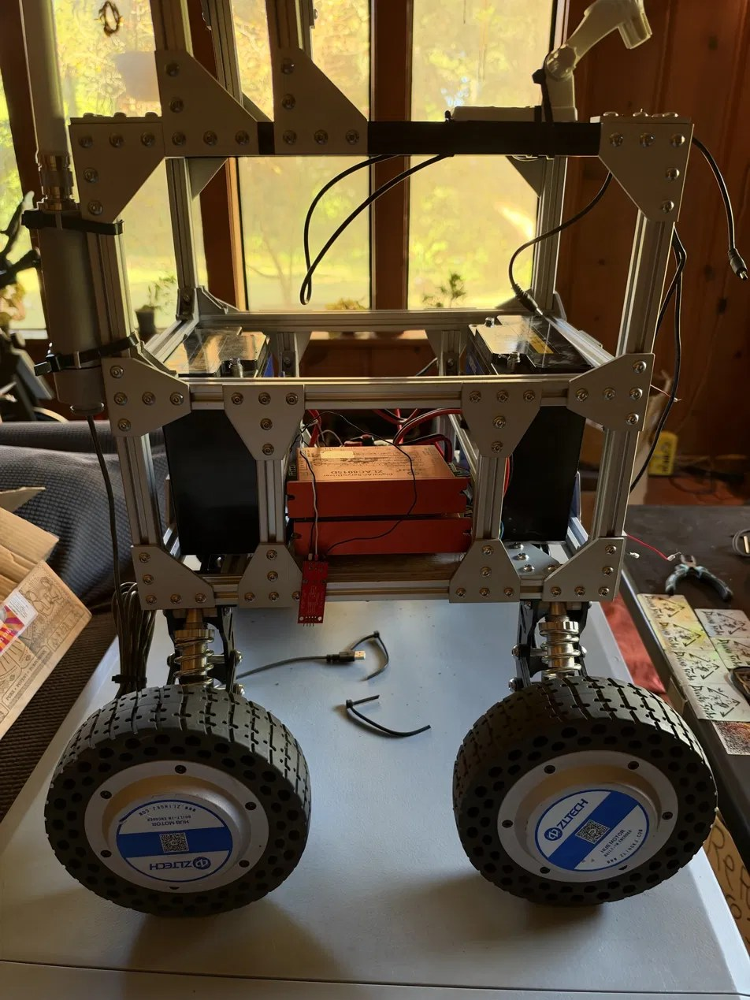
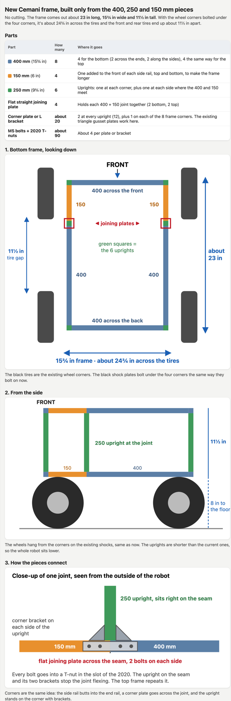

# Cemani rebuild, October 2026: longer frame and front steering

> **Current design, November 2026: [Front steering v3](#front-steering-v3-nov-2026).** Frame v3 (built 11/11) replaced frame v2.

## Front steering v3 (Nov 2026)

Each front corner turns on a UCF204-12 flange bearing (¾ in bore) bolted under the side rail and a short inboard 2020 rail (M5 x 18 screws, 12 x 5.2 sleeves, T-nuts). A ¾ x 2 in clevis pin is the kingpin. Under the bearing sits a ¼ in 6061 steering plate (98 x 167 mm), and a Ruland FHT-MCL-12E-F clamp collar under the plate locks the pin to it with 2 countersunk M6 x 16 screws. The existing black shock plate hangs under the steering plate on 15 mm standoffs with M5 x 40 screws, fender washers and nylocks, so the black plate, shock, arms and hub motor swivel together.

A 200 mm 5/16-24 tie rod with a CF5 heim joint on each end (8 mm spacers, 5/16 x 1-1/2 bolts) links the two plates ahead of the pins. One Glideforce LACT4P-12V-10 actuator (246 to 346 mm hole to hole) sits on bracket 2314 under a 110 mm 2020 stub that hangs under the left side rail about 10¼ in behind the front wheel centers; its rod end bolts to the right plate with a ¼-20 bolt. The Teensy 4.1 reads the actuator's pot and holds the angle. Inside wheel about 30° at full lock, which uses about 258 to 301 mm of the actuator.

Front axle first to test every part, then an identical rear axle for 4-wheel steering. Until the rear gets the same stack, the front sits about 54 mm (2⅛ in) lower under the frame than the back.

- [PARTS-ORDERED.md](../../steering-v3/PARTS-ORDERED.md) (what is ordered and its status), [PARTS-FRONT.md](../../steering-v3/PARTS-FRONT.md), [FIT_CHECK.md](../../steering-v3/FIT_CHECK.md), [PHYSICS.md](../../steering-v3/PHYSICS.md)
- **[Live 3D corner view](https://nicedreamzapp.github.io/CemaniHomesteadRobot/steering-v3-view/corner-cart.html)** (works on phone), buy list: [buy-list.html](../../steering-v3-view/buy-list.html)
- Plate DXFs: [steering-v3-view/plates/](../../steering-v3-view/plates/), cardboard template (print and test before cutting metal): [steering-v3-view/template/](../../steering-v3-view/template/)
- Whole-robot renders and Blender model: [frame-v3](frame-v3/README.md)

---

## October 2026 plan (old, kept for history)

> **Update, November 16:** the steering is now **4-wheel steering** with a UCF204 flange bearing on every corner. Design, interactive build and parts: [frame v3](frame-v3/README.md).

> **Update, October 25:** [frame v2](frame-v2/README.md) replaces the frame below. It's stiffer (cross rails at the wheel mounts, 8 uprights, a gusset at every joint, a one-piece top plate), the batteries sit low in the middle, and every board has a set spot.

Cemani sat for about five months after a wheel came off. The rebuild fixes the two things that bothered me most when it drove: the shudder in turns, and how easily a tall robot on a short footprint could tip.

The shudder is skid steer. With four fixed wheels, the tires get dragged sideways every time it turns. The fix is to steer the front wheels and let the Teensy slow the inside wheels in a turn, so nothing scrubs.

## The current build, measured

| What | Size |
|---|---|
| Frame, front to back | 400 mm (about 16 in) |
| Frame, side to side | about 12 in |
| Outside of left tire to outside of right tire | 21 in |
| Tires past the frame on each side | about 4½ in |
| Gap between front and rear tire | 4½ in |
| Tire diameter | 8 in |
| Floor to the underside of the frame | about 8 in |

The front and rear wheel centers are only about 12½ in apart, so the robot tips forward and back more easily than side to side. That 4½ in gap also leaves almost no room for a front wheel to turn before it hits the rear tire.

Measurement photos: [frame side](photos/measure-IMG_7729.jpg), [frame length](photos/measure-IMG_7730.jpg), [ground clearance](photos/measure-IMG_7731.jpg), [tire](photos/measure-IMG_7732.jpg), [tire overhang](photos/measure-IMG_7733.jpg).

## New frame

Built only from 2020 pieces already on hand (400, 250 and 150 mm), no cutting.

| Part | Count |
|---|---|
| 400 mm 2020 | 8 |
| 150 mm 2020 | 4 |
| 250 mm 2020 | 6 |
| Flat straight joining plates | 4 |
| Corner plates or L brackets | about 20 |
| M5 bolts and T-nuts | about 90 |

Each side rail is a 400 and a 150 joined with a flat plate, with a 250 upright standing right on the joint so it can't flex. That gives a frame about 23 in long, 15¾ in wide and 11½ in tall. With the same wheel corners it's about 24¾ in across the tires, which still fits through a 30 in door. The gap between front and rear tires grows to about 11½ in.
