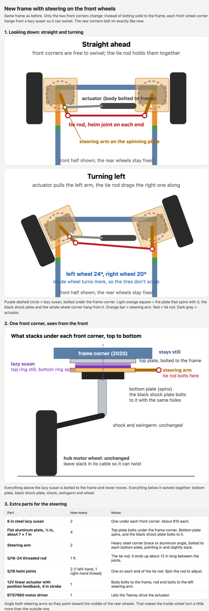

# Cemani rebuild, October 2026: longer frame and front steering

Cemani sat for about five months after a wheel came off. The rebuild fixes the two things that bothered me most when it drove: the shudder in turns, and how easily a tall robot on a short footprint could tip.

The shudder is skid steer. With four fixed wheels, the tires get dragged sideways every time it turns. The fix is to steer the front wheels and let the Teensy slow the inside wheels in a turn, so nothing scrubs.

## The current build, measured

| What | Size |
|---|---|
| Frame, front to back | 400 mm (about 16 in) |
| Frame, side to side | about 12 in |
| Outside of left tire to outside of right tire | 21 in |
| Tires past the frame on each side | about 4½ in |
| Gap between front and rear tire | 4½ in |
| Tire diameter | 8 in |
| Floor to the underside of the frame | about 8 in |

The front and rear wheel centers are only about 12½ in apart, so the robot tips forward and back more easily than side to side. That 4½ in gap also leaves almost no room for a front wheel to turn before it hits the rear tire.

Measurement photos: [frame side](photos/measure-IMG_7729.jpg), [frame length](photos/measure-IMG_7730.jpg), [ground clearance](photos/measure-IMG_7731.jpg), [tire](photos/measure-IMG_7732.jpg), [tire overhang](photos/measure-IMG_7733.jpg).

## New frame

Built only from 2020 pieces already on hand (400, 250 and 150 mm), no cutting.

| Part | Count |
|---|---|
| 400 mm 2020 | 8 |
| 150 mm 2020 | 4 |
| 250 mm 2020 | 6 |
| Flat straight joining plates | 4 |
| Corner plates or L brackets | about 20 |
| M5 bolts and T-nuts | about 90 |

Each side rail is a 400 and a 150 joined with a flat plate, with a 250 upright standing right on the joint so it can't flex. That gives a frame about 23 in long, 15¾ in wide and 11½ in tall. With the same wheel corners it's about 24¾ in across the tires, which still fits through a 30 in door. The gap between front and rear tires grows to about 11½ in.

## Front steering

Each front wheel corner (black shock plate, shock, swingarm and hub motor) hangs from a 6 in steel lazy susan bolted under the frame corner, so the whole corner swivels. A steering arm on each spinning plate points in and slightly back toward the middle of the rear axle, and a tie rod with a heim joint on each end links the two arms. One linear actuator with position feedback pushes the left arm. Angling the arms that way makes the inside wheel turn a few degrees more than the outside one.

The rear corners don't change. Nothing needs welding.

| Steering part | Count |
|---|---|
| 6 in steel lazy susan | 2 |
| ¼ in aluminum plate, about 7 × 7 in | 4 |
| Steering arm (steel corner brace or aluminum angle) | 2 |
| 5/16-24 threaded rod | 1 ft |
| 5/16 female heim joints, one left-hand and one right-hand | 2 |
| 12V linear actuator with feedback, 4 in stroke | 1 |
| BTS7960 motor driver | 1 |

On the software side, the Teensy reads the actuator's position, holds the steering angle, and sets each hub motor's speed for its turning radius.

## Still to measure

The black shock plate's size and bolt spacing. That decides whether the lazy susan bolts straight to it or needs the adapter plate.
