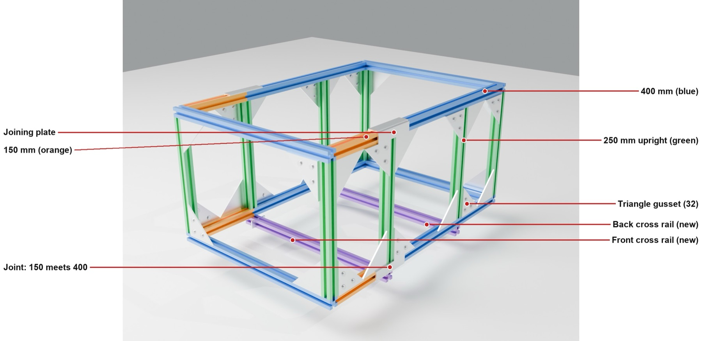
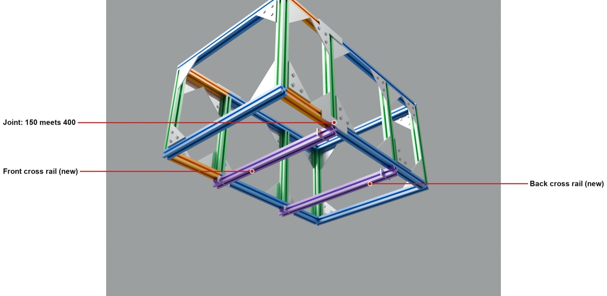
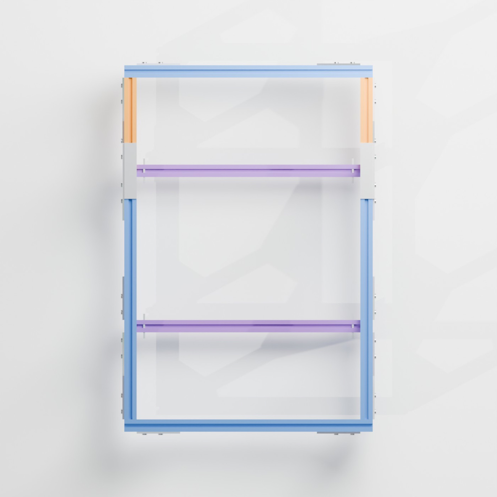
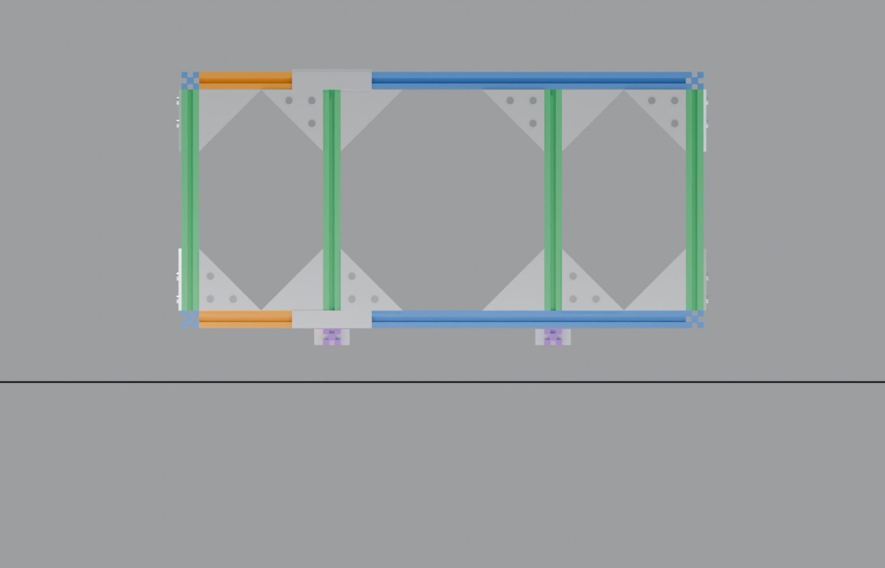
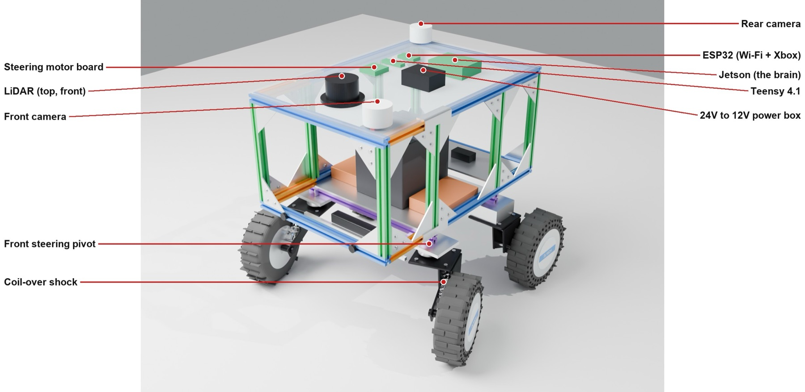
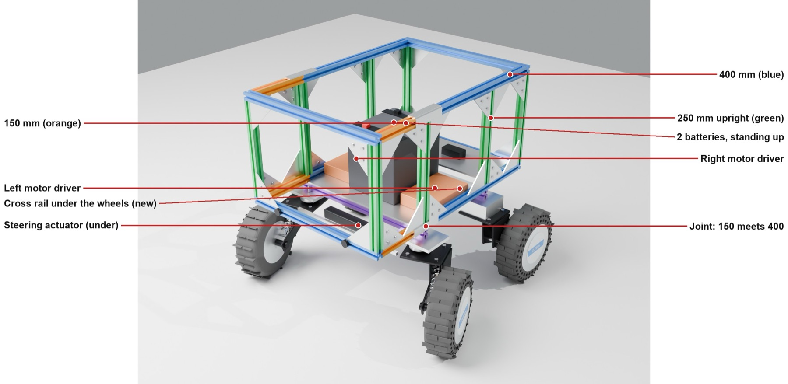
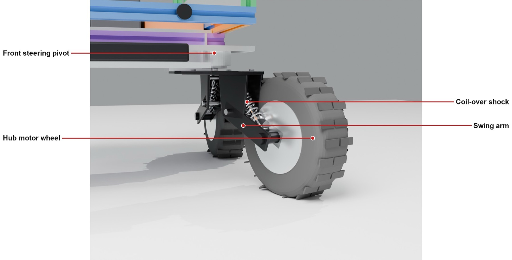
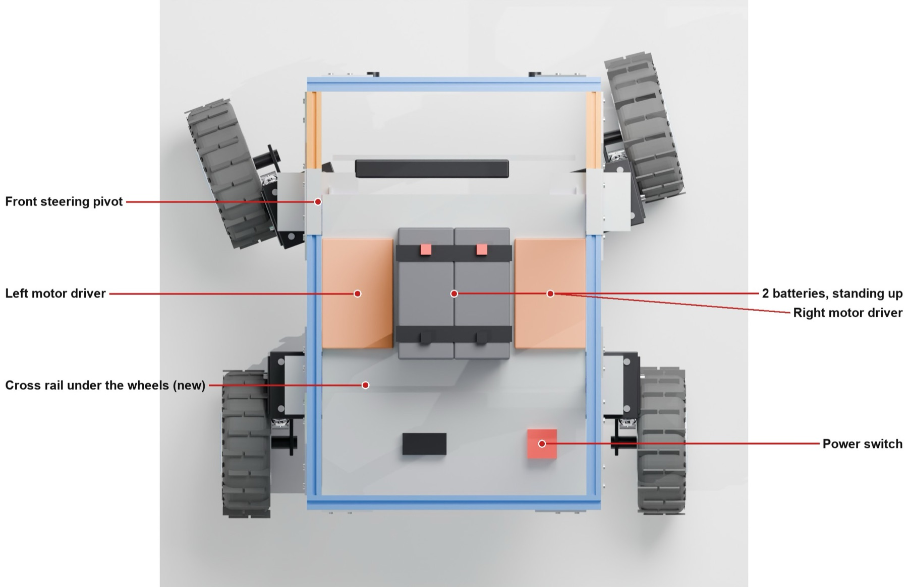
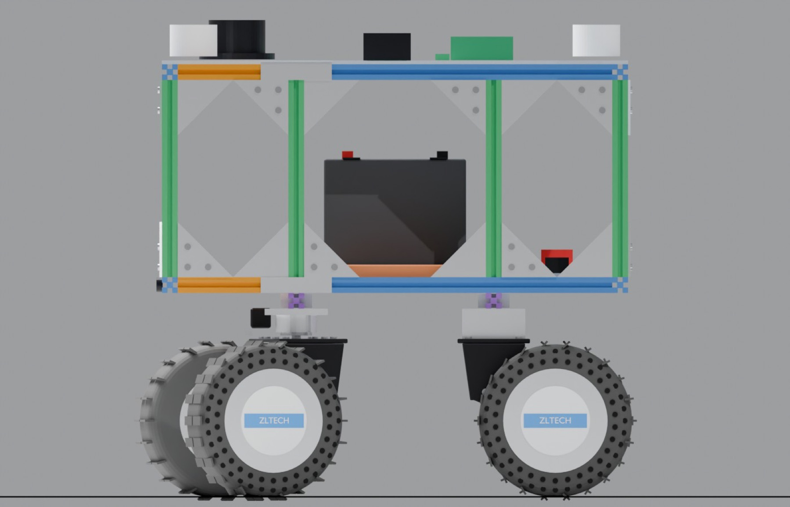

# Frame v2: stiffer, 3 levels, room for steering

October 25, 2026. This is the second pass at the rebuild frame. The first pass (in the [rebuild plan](../README.md)) got the length right. This one makes it stiff enough for front steering and pulling a cart, puts the batteries low, and gives every board a set spot.

I'm building it this week from the 2020 pieces off the current robot. I'll add photos of the real frame when it's together.



## Goals

- **Steering instead of tank turns.** Skid steer drags the tires sideways and shakes the whole robot. The front wheels will steer and the back wheels will roll.
- **Steady.** The heavy parts go low and in the middle, on a wide stance.
- **Same parts.** It's all the 2020 extrusion, gussets and brackets I already have.
- **More personality.** The top plate is a flat, clean base for an R2-D2 style head later.

## The frame

| What | Size |
|---|---|
| Frame | about 23¼ in long × 15¾ in wide × 11½ in tall |
| Across the tires | about 24¾ in (fits a 30 in door) |
| Front axle to back axle | about 16 in |
| Gap between the front and back tires | about 8 in, double what it is now |
| Floor to the bottom of the frame | about 10 in |

| Piece | Count | Where |
|---|---|---|
| 400 mm 2020 | 10 | 8 for the top and bottom boxes, plus 2 cross rails |
| 150 mm 2020 | 4 | on the front of each side rail, top and bottom |
| 250 mm 2020 | 8 | uprights: 4 corners, plus one over each end of each cross rail |
| Triangle gussets | 32 | top and bottom of every upright |
| Flat joining plates | 6 | across the 150/400 joints |
| M5 bolts and T-nuts | about 170 | |

**What makes it stiffer than v1:**

1. **Two cross rails at the wheel mounts.** A rail runs side to side where each pair of wheels mounts, and both wheel plates bolt to it. Bumps go into a full-width rail instead of one corner joint. The front one sits at the 150/400 joints and backs them up.
2. **Eight uprights, not six.** An upright stands over each end of each cross rail, so weight goes straight up and down.
3. **A gusset at the top and bottom of every upright,** on the sides, front and back. This is what stops the box from leaning into a parallelogram.
4. **A one-piece top plate,** 15¾ × 23¼ in, bolted all the way around. It stiffens the whole top like a lid on a box.
5. **The 150/400 joints are plated on two faces.**

**Note on the drawings:** the renders show the two cross rails hanging under the bottom rails. In the real build they fit flush between the side rails, so nothing sticks out and everything lines up. That may make the frame a little longer than the numbers above.



| Above | Side |
|---|---|
|  |  |

### Build order

1. Join each side rail: a 150 and a 400, with a flat plate across the joint. Make 4 of them, 2 for the bottom and 2 for the top.
2. Build the bottom box: the side rails between the two end 400s, with a gusset at every corner.
3. Fit the 2 cross rails: one at the front joints, and one the same distance in from the back.
4. Stand the 8 uprights and put a gusset at the bottom of each.
5. Put the top box on, and add the gussets at the top of each upright.
6. Square it up: measure both diagonals of the top and bottom until they match, then tighten everything.

## Where everything goes





**Bottom deck (the heavy stuff):** a 3/16 in aluminum plate on the cross rails.

- **2 batteries,** DC HOUSE 12V 30Ah LiFePO4 wired in series for 24V. Each is 7.1 × 3.0 × 6.5 in. They stand side by side in the middle, strapped down.
- **2 ZLAC8015D motor drivers,** about 150 × 97 × 31 mm each, lying flat on either side of the batteries.
- **A small back plate** for the main power switch and fuse.

**Top deck (the light stuff):**

- the Jetson Orin Nano, Teensy 4.1 and ESP32
- the 24V to 12V converter and the steering motor driver
- the RPLidar at the front, high and in the middle, so it sees all the way around
- the front and rear PTZ cameras

**Under the front:** the steering actuator and tie rod. The ultrasonic sensors go on the front bottom rail.

## The corners



The corners are drawn from photos of the current robot, and each wheel module stays exactly as it is. A black plate bolts under the frame, and two black side plates hang from it. A double swing arm pivots at their bottom and reaches out toward the end of the robot to the hub motor's axle. A coil-over shock sits at an angle between the side plates, from the top plate down to the arm near the axle.

At the front, the steering pivot goes between the frame and the black plate (see [the steering plan](../README.md#front-steering)). At the back, a spacer of the same height keeps the robot level.

| Turning left, from above | From the side |
|---|---|
|  |  |

## Steering assist

Each front wheel sits off to the side of its pivot, so it swings around in a small arc as it steers. The hub motors can help: the Teensy spins the two front wheels at slightly different speeds to swing them into the turn. That way the actuator only has to aim the wheels and hold them, not drag the tires around. The Teensy also sets each wheel's speed for its own turning circle, so nothing scrubs.

## Still to buy for the frame

- Bottom deck plate, 3/16 in aluminum, about 14 × 10⅝ in
- Back plate, 3/16 in aluminum, about 14 × 5½ in
- Top plate, 1/8 in aluminum, about 15¾ × 23¼ in
- 2 battery straps and a rubber pad
- M4 bolts for the drivers, and M3 standoffs for the boards

Exact plate sizes come after the real frame is built and measured.

## The model

The renders come from [`model/cemani_frame.py`](model/cemani_frame.py), a Blender script. To rebuild any view:

```
blender -b --factory-startup -P model/cemani_frame.py -- iso
blender -b --factory-startup -P model/cemani_frame.py -- iso bare
```

The views are `iso`, `isob`, `top`, `side`, `under` and `corner`. Add `notop` to hide the top deck, or `bare` to draw just the frame.
