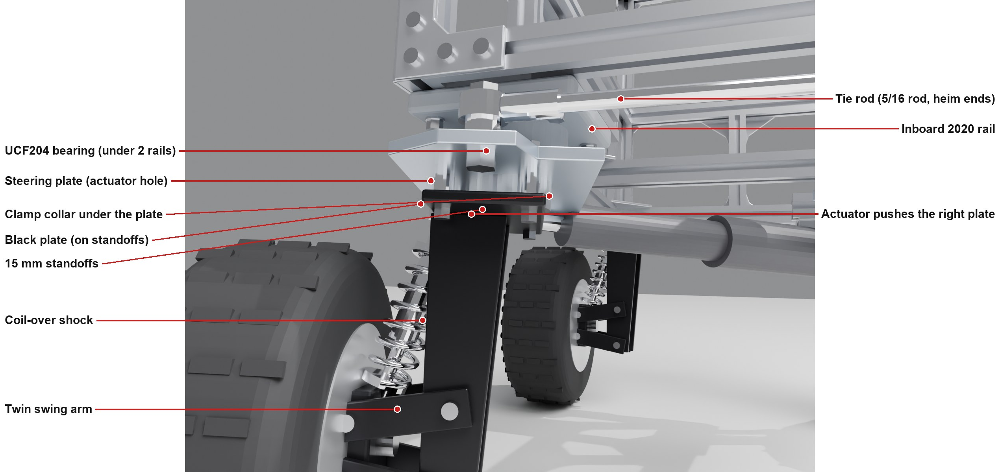

# Frame v3: the rebuilt frame with front steering

The frame as rebuilt in November 2026: a low box in front, and a tall box over the back with two black rails on top. The front wheels steer.

## Measurements (taken with a tape on the real frame)

| What | Size |
|---|---|
| Bottom rail, front to back | about 22¼ in |
| Frame width | about 12 in |
| Floor to bottom of frame | about 8¾ in |
| Floor to top of low box | about 15½ in |
| Floor to top of tall box | about 22½ in |
| Axle to axle | about 18 in |
| Outside tire to outside tire | 21 in |
| Tires | 8 in |

## Front steering (v3, November 2026)

Each front corner, top to bottom: the side rail and a short inboard 2020 rail (64 mm apart), a UCF204-12 flange bearing bolted under both (M5 x 18, 12 x 5.2 sleeves, T-nuts), a 3/4 x 2 in clevis pin as the kingpin, a 1/4 in aluminum steering plate (98 x 167 mm) under the bearing, a Ruland 3/4 in clamp collar under the plate (2 countersunk M6 x 16), then the black suspension plate on four 15 mm standoffs (M5 x 40, fender washer and nylock), then the shock and the wheel. No lazy susan.

A 200 mm 5/16-24 tie rod with a CF5 heim joint on each end links the two plates, about 246 mm hole to hole. One Glideforce LACT4P-12V-10 actuator (246 to 346 mm) on bracket 2314, under a 110 mm 2020 stub below the left side rail about 10 1/4 in behind the front wheels, pushes the right plate. Inside wheel 30 deg at full lock (outside about 27 deg); the actuator runs about 258 to 301 mm, with about 12 mm spare closed and 45 mm open.

The front stack is 54 mm deep. Front steering goes in first; the back corners stay bolted straight under the rail until the identical rear axle is built, so for now the robot sits nose-up about 7 deg in the renders.

| Side | From above |
|---|---|
|  |  |

Detail and order status: [steering-v3/PARTS-ORDERED.md](../../../steering-v3/PARTS-ORDERED.md), [FIT_CHECK.md](../../../steering-v3/FIT_CHECK.md), [PHYSICS.md](../../../steering-v3/PHYSICS.md), corner view [corner-cart.html](../../../steering-v3-view/corner-cart.html), plate DXFs [steering-v3-view/plates/](../../../steering-v3-view/plates/).

The earlier 11/11 version of this page (eared KFL001 bearing, flat thrust washer bearing, M12 bolt, actuator on the middle cross rail, 1 1/2 in back spacers) is an old design and is not being built.

## Parts list

Current: [steering-v3/PARTS-ORDERED.md](../../../steering-v3/PARTS-ORDERED.md). `PARTS.md` and `plates/` in this folder are the old 11/11 design.

## Model

`model/cemani_frame_v3.py` is the Blender script. Run it with `blender -b --factory-startup -P cemani_frame_v3.py -- iso|side|top|corner` (renders to `/tmp/cemani/render3/` plus `steer_stats.json` with the tie rod, steering angles and actuator lengths), then `python3 model/callouts.py` to label the renders and write the four jpgs here.
