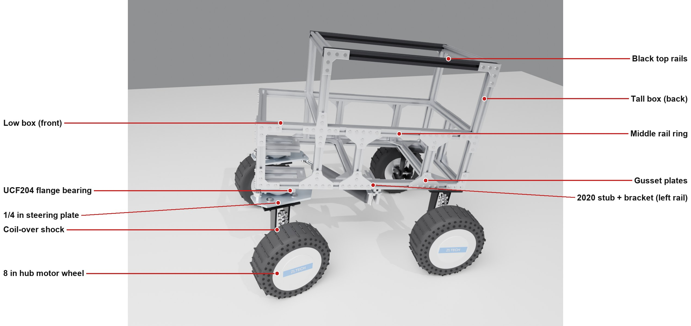
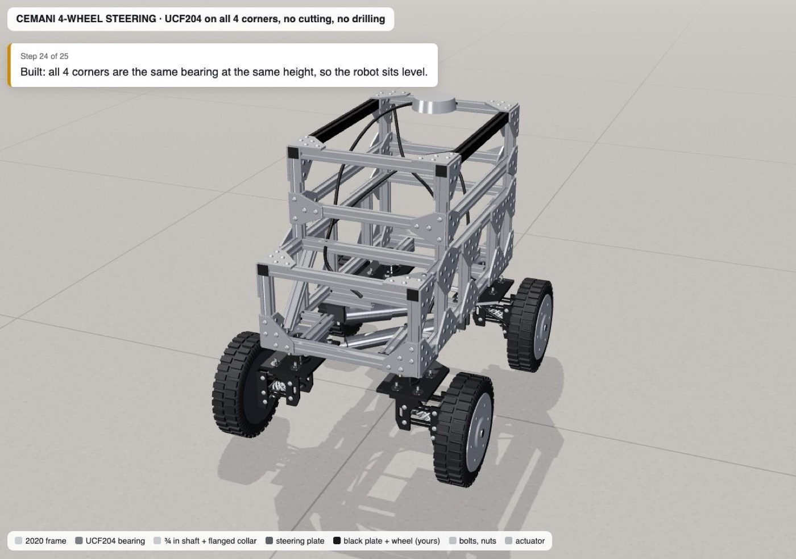
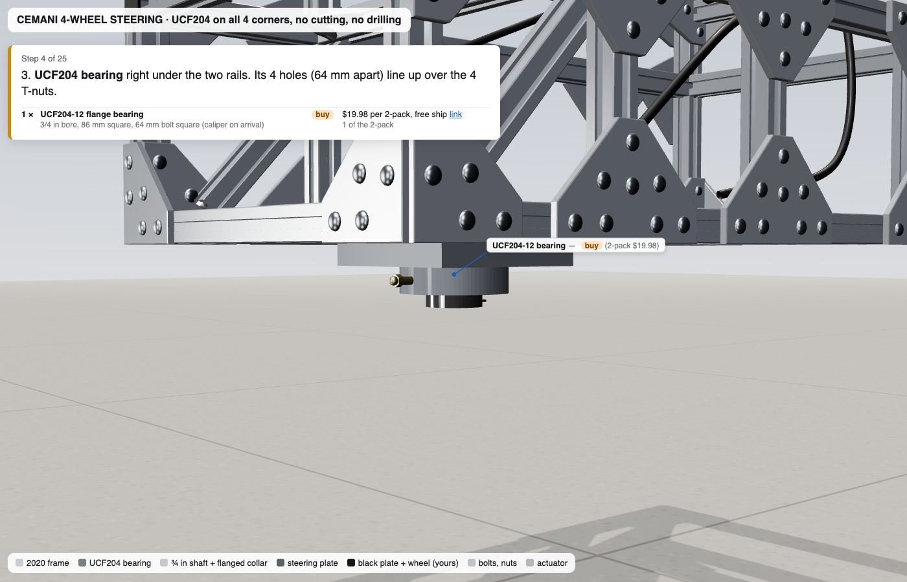
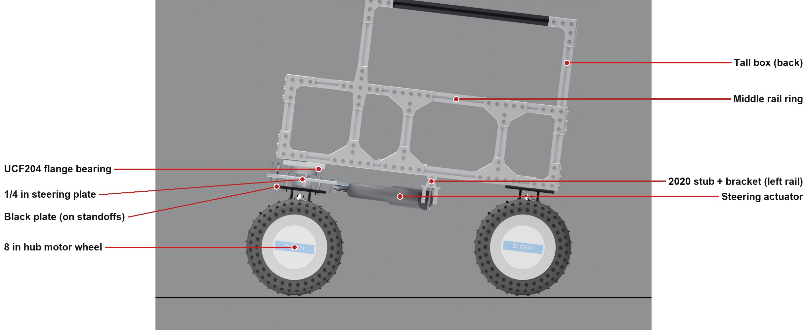
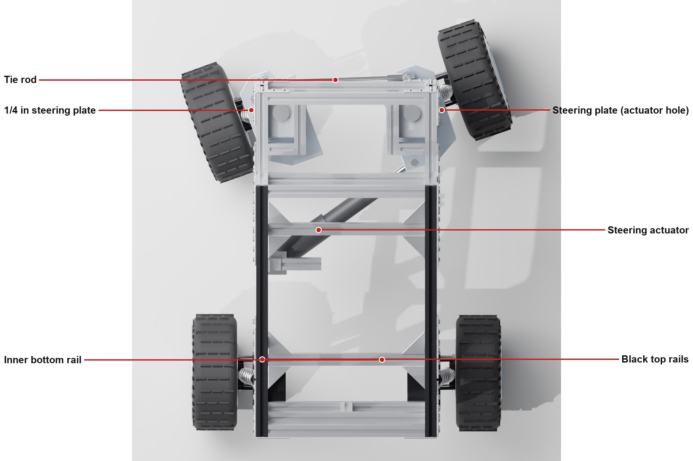

# Frame v3: the rebuilt frame with 4-wheel steering

The frame as rebuilt in November 2026: a low box in front, and a tall box over the back with two black rails on top. All four wheels steer (decided November 16, 2026). The front gets built first, the back after.

## Measurements (taken with a tape on the real frame)

| What | Size |
|---|---|
| Bottom rail, front to back | about 22¼ in |
| Frame width | about 12 in |
| Floor to bottom of frame | about 8¾ in |
| Floor to top of low box | about 15½ in |
| Floor to top of tall box | about 22½ in |
| Axle to axle | about 18 in |
| Outside tire to outside tire | 21 in |
| Tires | 8 in |

## 4-wheel steering (November 16 design)

**Interactive build:** [watch it build itself, part by part](https://raw.githack.com/nicedreamzapp/CemaniHomesteadRobot/main/docs/rebuild-2026/frame-v3/assembly/viewer-4ws-ucf204.html?real). Every step shows the parts it adds, how many, and whether to buy them. "Front parts list" opens the whole front shopping list. Side by side with photos of the real robot: [compare page](https://raw.githack.com/nicedreamzapp/CemaniHomesteadRobot/main/docs/rebuild-2026/frame-v3/assembly/compare-real.html).

All four corners are the same. Top to bottom:
- **Frame:** the side rail plus a second short 2020 rail 64 mm inboard of it.
- **Bearing:** a UCF204-12 4-bolt flange bearing (¾ in bore) under the two rails, held by 4 M6 bolts into drop-in T-nuts. No adapter plate.
- **Shaft:** a ¾ in steel shaft up into the bearing, with a collar under the bearing that carries the wheel load.
- **Plates:** a laser-cut ¼ in steering plate, then the black suspension plate with its shock and hub motor wheel.

Each axle has a 5/16 tie rod with a heim joint on each end and one Glideforce 4 in actuator (246 to 346 mm). The front actuator sits on a bracket under a short 2020 piece under the left side rail, about 10¼ in behind the front wheels. The back one mirrors it under the right side rail. Across ±30° the actuator needs about 258 to 305 mm, so it has room at both ends.

Turning circle: about 8.8 ft with front steering only, about 5.9 ft with all four wheels steering (back wheels turn the opposite way).

No cutting, welding or drilling: the plates are laser cut, and the shafts are bought cut to length. Sizes for the collar, shaft and plates get confirmed once the bearings arrive and are measured. See `assembly/FIT_CHECK.md`.

The older eared-bearing and lazy susan designs are replaced. Pictures below are the frame itself.

| Side | From above |
|---|---|
|  |  |

## Parts list

See `PARTS.md`: the front first, in buying order.

## Model

`model/cemani_frame_v3.py` is the Blender script. Run it with `blender -b --factory-startup -P cemani_frame_v3.py -- iso|side|top|corner`.
