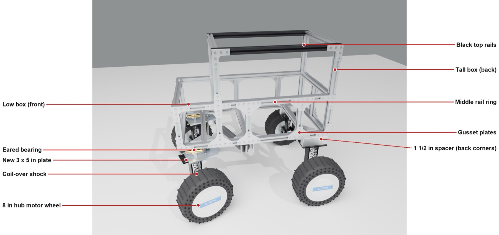
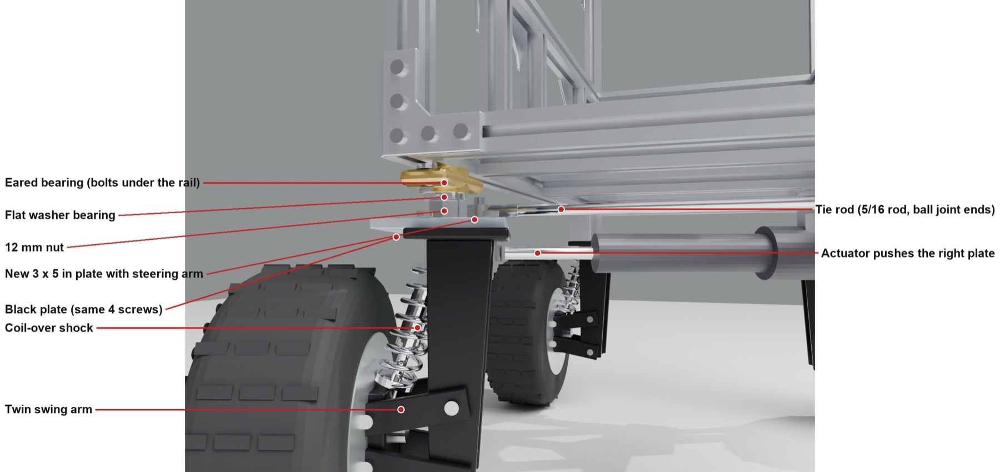
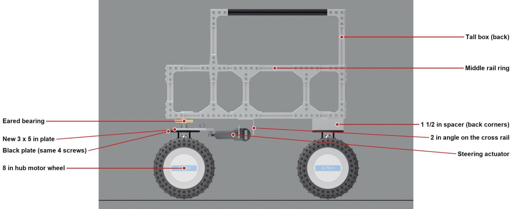
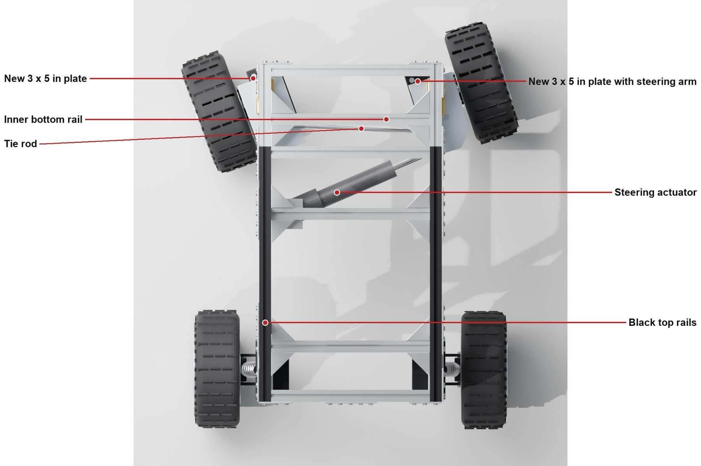

# Frame v3: the rebuilt frame with front steering

The frame as rebuilt in November 2026: a low box in front, and a tall box over the back with two black rails on top. The front wheels steer.

## Measurements (taken with a tape on the real frame)

| What | Size |
|---|---|
| Bottom rail, front to back | about 22¼ in |
| Frame width | about 12 in |
| Floor to bottom of frame | about 8¾ in |
| Floor to top of low box | about 15½ in |
| Floor to top of tall box | about 22½ in |
| Axle to axle | about 18 in |
| Outside tire to outside tire | 21 in |
| Tires | 8 in |

## Front steering

Each front corner, top to bottom: the bottom rail, the eared bearing (12 mm flange), the flat washer bearing (12 mm thrust), a 12 mm lock nut, a new 3 × 5 × ¼ in aluminum plate with a built-in steering arm, and then the black suspension plate on its same 4 screws, followed by the shock and the wheel.

A 5/16 tie rod with a heim joint on each end links the two steering arms. It is about 9¾ in from hole to hole. A 4 in stroke linear actuator pushes the right plate. The inside wheel turns up to about 30°, which uses about 2⅛ in of the stroke.

The stack lifts the front about 1½ in, so the two back corners get 1½ in spacers cut from 2020 rail.

| Side | From above |
|---|---|
|  |  |

## Parts list

See `PARTS.md`.

## Model

`model/cemani_frame_v3.py` is the Blender script. Run it with `blender -b --factory-startup -P cemani_frame_v3.py -- iso|side|top|corner`.
